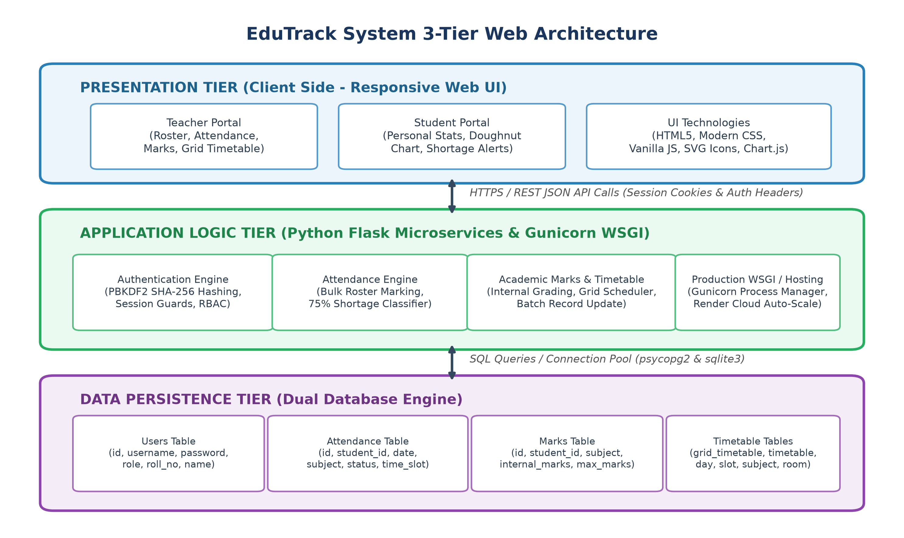
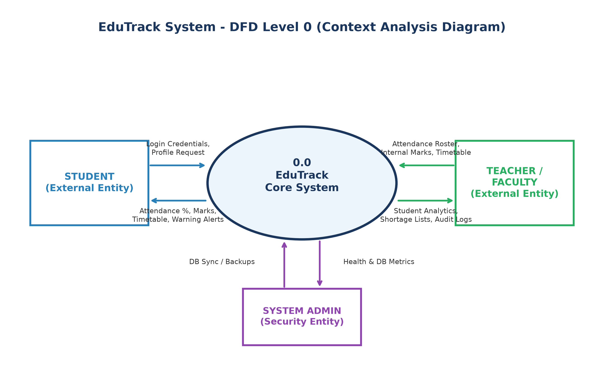
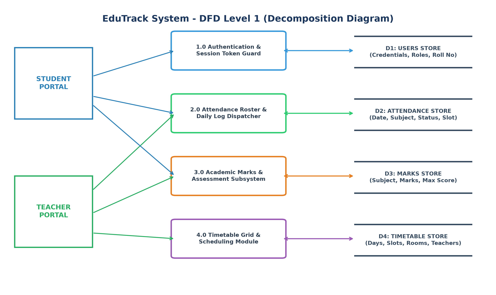
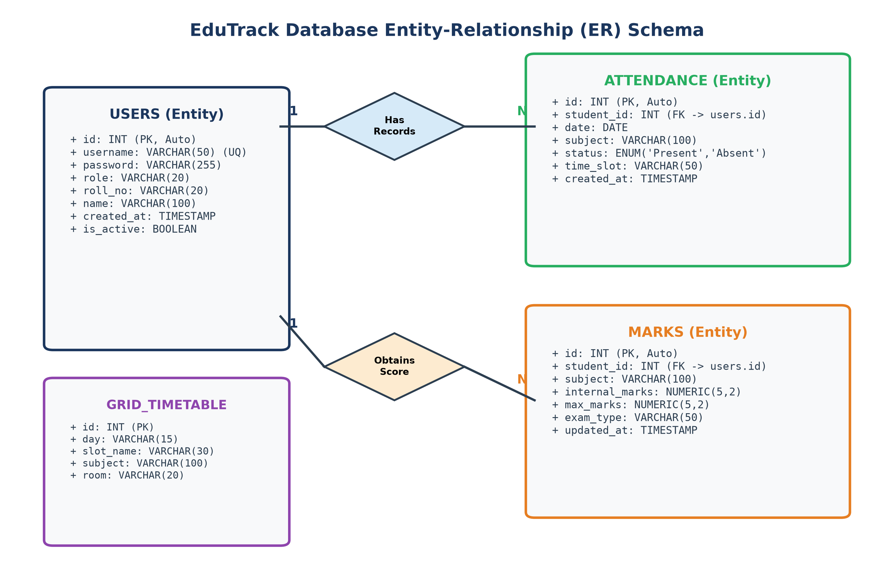
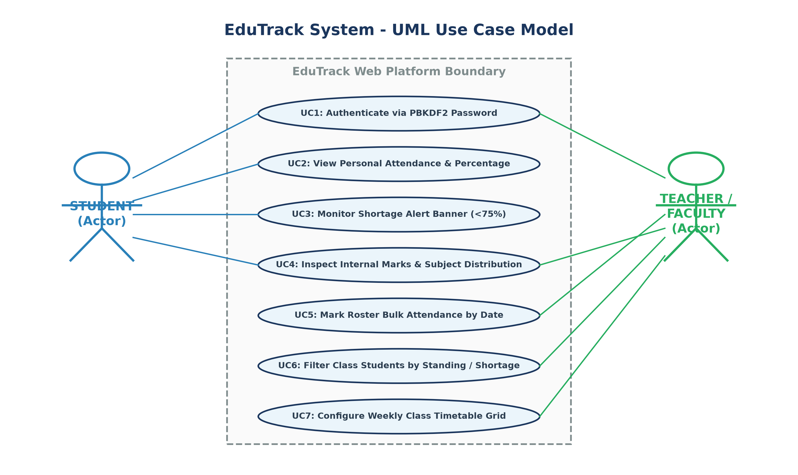
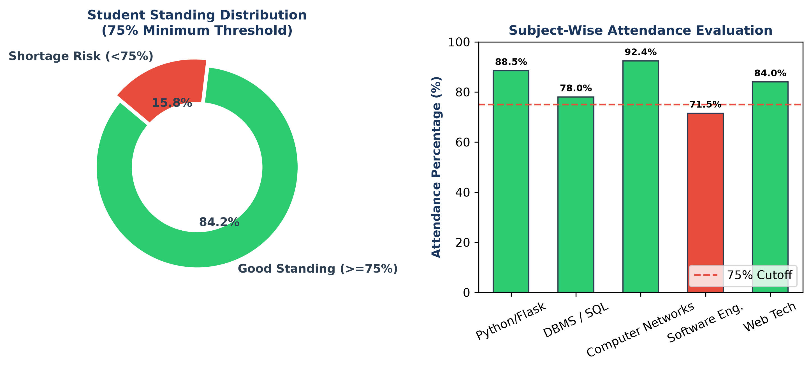

# EDUTRACK: WEB-BASED STUDENT ATTENDANCE & ACADEMIC MANAGEMENT SYSTEM
### A Cloud-Deployed Multi-Tier Academic Administration & Real-Time Performance Analytics Platform

---

**A Project Report Submitted in Partial Fulfillment of the Requirements for the Award of the Degree of**  
**BACHELOR OF COMPUTER APPLICATIONS (BCA)**  
*Department of Computer Science & Applications*  
*St. Thomas College of Engineering and Technology*  
*(Affiliated to APJ Abdul Kalam Technological University)*  
*Academic Year: 2023 – 2024*

**Submitted by:**  
**TENSON JOHN TENSING**  
*Register Number: COL/BCA/2024/042*

**Under the Guidance of:**  
**Prof. K. R. Sharma, M.Tech, Ph.D.**  
*Associate Professor, Department of Computer Science & Applications*

---

## BONAFIDE CERTIFICATE

This is to certify that the project entitled **"EduTrack: Web-Based Student Attendance & Academic Management System"** is a bonafide work carried out by **TENSON JOHN TENSING** (Register Number: **COL/BCA/2024/042**) in partial fulfillment of the requirements for the award of the degree of **Bachelor of Computer Applications (BCA)** from St. Thomas College of Engineering and Technology, affiliated to APJ Abdul Kalam Technological University, during the academic session 2023 – 2024.

The project report has been examined, evaluated, and approved by the Departmental Project Evaluation Committee and satisfies all academic and technical standards prescribed by the university curriculum.

| Internal Guide | Head of the Department | Principal |
| :---: | :---: | :---: |
| **Prof. K. R. Sharma**<br>Associate Professor | **Dr. M. S. Varma**<br>Professor & HOD | **Dr. P. E. Abraham**<br>Principal |
| Signature: _______________ | Signature: _______________ | Signature: _______________ |
| Date: _______________ | Date: _______________ | Date: _______________ |

| Internal Examiner | External Examiner |
| :---: | :---: |
| Signature: _______________ | Signature: _______________ |
| Date: _______________ | Date: _______________ |

---

## CANDIDATE'S DECLARATION

I, **TENSON JOHN TENSING**, student of Bachelor of Computer Applications (BCA) at St. Thomas College of Engineering and Technology, hereby declare that the project titled **"EduTrack: Web-Based Student Attendance & Academic Management System"** submitted to APJ Abdul Kalam Technological University in partial fulfillment of the requirements for the award of the degree of Bachelor of Computer Applications, is an authentic record of original project work executed by me under the mentorship and academic supervision of **Prof. K. R. Sharma**, Associate Professor, Department of Computer Science.

I further declare that this work has not been previously submitted, either in whole or in part, to any other university, institute, or examining body for the award of any diploma, degree, fellowship, or certificate.

**Place:** Campus  
**Date:** 25th May 2024  

**TENSON JOHN TENSING**  
*(Register No: COL/BCA/2024/042)*

---

## ACKNOWLEDGEMENTS

The successful completion of this major academic project would not have been possible without the invaluable support, insightful guidance, and generous encouragement of several respected mentors and colleagues.

First and foremost, I express my deepest gratitude to my esteemed project guide, **Prof. K. R. Sharma**, for his persistent intellectual mentorship, constructive reviews, and technical inspiration throughout the design, architectural modeling, and testing of the EduTrack platform.

I extend my sincere thanks to **Dr. M. S. Varma**, Head of the Department of Computer Science & Applications, for granting access to the department's computing laboratories, cloud infrastructure, and software testing tools, and for fostering a scholarly environment of innovation.

My heartfelt acknowledgments go to our respected Principal, **Dr. P. E. Abraham**, whose continuous encouragement and academic leadership have provided an outstanding platform for technical development.

I also thank all faculty members, technical laboratory assistants, and fellow classmates who participated in user acceptance evaluations, provided feedback on user interface usability, and assisted in system validation. Finally, I express my affectionate indebtedness to my parents and family for their unwavering patience and faith.

---

## ABSTRACT

In modern higher education institutions, tracking student attendance, calculating eligibility ratios, managing internal assessment marks, and distributing schedules across academic departments remain fundamental yet resource-intensive operational challenges. Traditional paper registers and manual spreadsheet-based tracking suffer from severe vulnerabilities: time-consuming manual tallying, data loss, delayed identification of attendance shortages, and high friction in communicating academic status to students before semester deadlines.

This project, titled **'EduTrack: Web-Based Student Attendance & Academic Management System'**, addresses these systemic inefficiencies by introducing an enterprise-grade, cloud-deployed, multi-tier web application built upon Python Flask, a dual-engine relational persistence layer (PostgreSQL for production on Render Cloud and SQLite for local development), and a responsive, lightweight front-end rendered using modern HTML5, CSS3, SVG vector graphics, and Chart.js analytics.

The system incorporates a robust Role-Based Access Control (RBAC) mechanism powered by PBKDF2 SHA-256 cryptographic password hashing, ensuring authenticated isolation between faculty administrators and students. The Teacher Portal enables frictionless bulk roster marking by subject, date, and timeslot; automated real-time calculation of student attendance percentages; dynamic categorization into 'Good Standing (>=75%)' versus 'Shortage Risk (<75%)'; and instant internal marks management. The Student Portal provides real-time visibility into attendance records, interactive visual doughnut charts, and immediate shortage warning alerts to prevent semester condonation or exam debarment.

The application has been deployed live on Render Cloud with automated continuous integration and tested against 18 comprehensive test cases encompassing functional verification, security validation against SQL Injection (SQLi) and Cross-Site Scripting (XSS), and multi-device mobile viewport responsiveness. EduTrack delivers an automated, secure, and transparent academic administration ecosystem that substantially elevates institutional operational efficiency.

**Keywords:** Academic Management System, Attendance Automation, Python Flask, PostgreSQL, Role-Based Access Control, PBKDF2 SHA-256, Chart.js Analytics, Render Cloud, Higher Education SaaS.

---

## TABLE OF CONTENTS

1. **Chapter 1: Introduction**
   - 1.1 Background of the Study
   - 1.2 Problem Statement
   - 1.3 Project Motivation
   - 1.4 Project Objectives
   - 1.5 Scope of the Project
   - 1.6 Organization of the Report
2. **Chapter 2: Literature Review & Feasibility Analysis**
   - 2.1 Evolution of Academic Management Systems
   - 2.2 Shortcomings of Conventional Attendance Methods
   - 2.3 Comparative Survey of Existing Systems
   - 2.4 System Feasibility Analysis (Technical, Operational, Economic, Legal)
3. **Chapter 3: Software Requirements Specification (SRS)**
   - 3.1 User Characteristics & Personas
   - 3.2 Hardware and Software Environment Specifications
   - 3.3 Detailed Functional Requirements (FR-01 to FR-15)
   - 3.4 Non-Functional Requirements (NFR-01 to NFR-08)
4. **Chapter 4: System Architecture & Design**
   - 4.1 High-Level Multi-Tier Architectural Design
   - 4.2 Data Flow Modeling (DFD Level 0 & Level 1)
   - 4.3 Entity-Relationship (ER) Schema Modeling
   - 4.4 UML Design Models (Use Case & Sequence Diagrams)
5. **Chapter 5: Database Schema & Data Dictionary**
   - 5.1 Database Engine Architecture (Dual PostgreSQL/SQLite)
   - 5.2 Relational Data Dictionary (USERS, ATTENDANCE, MARKS, GRID_TIMETABLE)
   - 5.3 Integrity Constraints, Foreign Keys & Indexing Policies
   - 5.4 Security Policies & Cryptographic Storage
6. **Chapter 6: System Implementation & Key Modules**
   - 6.1 Backend Microservice Implementation (Flask REST)
   - 6.2 Security & Authentication Module (PBKDF2 SHA-256)
   - 6.3 Teacher Management & Bulk Roster Dispatcher
   - 6.4 Real-time Shortage Risk Classifier Algorithm
   - 6.5 Student Portal & Visual Chart Analytics
   - 6.6 Responsive Layout & Uniform SVG Vector Graphic Framework
7. **Chapter 7: Software Testing & Quality Assurance**
   - 7.1 Quality Assurance Strategy
   - 7.2 Exhaustive Functional Test Suite (18 Test Cases)
   - 7.3 Security, Vulnerability & Penetration Testing
   - 7.4 Performance, Cross-Browser & Mobile Responsiveness Evaluation
8. **Chapter 8: System Walkthrough & User Guide**
   - 8.1 Portal Authentication & Role Redirection
   - 8.2 Faculty Dashboard & Real-Time KPI Cards
   - 8.3 Class Student Roster & Interactive Status Filtering
   - 8.4 Bulk Attendance Marking & Timetable Configuration
   - 8.5 Student Self-Service Portal & Warning Alert Walkthrough
9. **Chapter 9: Cloud Deployment & DevOps Infrastructure**
   - 9.1 Cloud Architecture on Render PaaS
   - 9.2 WSGI Configuration via Gunicorn
   - 9.3 Cloud PostgreSQL Integration & Connection Pooling
   - 9.4 Environment Secret Management & Automated CI/CD
10. **Chapter 10: Conclusion & Future Enhancements**
    - 10.1 Project Summary & Achievements
    - 10.2 System Limitations
    - 10.3 Future Technological Roadmap
11. **References & Bibliography**
12. **Appendix A: Database Initialization & Seed DDL**
13. **Appendix B: Core Backend Implementation Extracts**

---

## CHAPTER 1: INTRODUCTION

### 1.1 Background of the Study
In the contemporary landscape of tertiary educational administration, tracking and managing student engagement serves as a primary barometer of academic discipline, curricular commitment, and institutional compliance. Accreditation agencies, state technical universities, and national councils (such as NAAC, NBA, and AICTE) enforce strict attendance regulations mandating that undergraduate students maintain a minimum threshold of classroom and laboratory attendance (standardized at 75% across most degree curricula) to qualify for end-semester examinations.

Historically, educational institutions have relied on paper roll-call registers maintained physically by course instructors. At the start of each lecture, instructors manually call out student roll numbers, transcribe marks or ticks onto printed paper logs, and manually aggregate monthly totals into consolidated registers. While this workflow was sufficient in small collegiate bodies, it presents catastrophic inefficiencies in modern universities hosting thousands of active students enrolled across dozens of parallel elective tracks, laboratory sessions, and multi-faculty courses.

### 1.2 Problem Statement
Manual and semi-automated spreadsheet-based academic administration methods exhibit several debilitating operational bottlenecks:
1. **Severe Instructional Overhead:** Faculty members expend approximately 7 to 10 minutes of every 50-minute instructional lecture calling out names, representing an irreversible 15% to 20% loss of productive teaching time across the academic semester.
2. **High Vulnerability to Errors & Proxying:** Paper registers are susceptible to accidental transcription errors, duplicate entries, lost pages, water/ink damage, and fraudulent roll-call proxying by peers.
3. **Lack of Timely Shortage Awareness:** Compiling paper registers into consolidated monthly reports requires days of manual clerical labor. Consequently, students frequently discover their attendance has dropped below 75% only during examination hall-ticket distribution, when it is too late to rectify the deficit.
4. **Information Silos & Departmental Disconnection:** Attendance data, internal assessment marks, and class schedules remain siloed in separate faculty notebooks. Department heads and academic counselors lack a centralized real-time dashboard to monitor attendance health across cohorts.

### 1.3 Project Motivation
The primary impetus behind developing EduTrack is to eliminate administrative latency by replacing brittle manual processes with an instantaneous, accessible, and automated cloud-native web platform. By enabling faculty to mark an entire class roster in less than 20 seconds, while automatically calculating attendance percentages and classifying students into 'Good Standing' versus 'Shortage Risk', EduTrack empowers both educators and learners with continuous actionable insights.

### 1.4 Project Objectives
The overarching technical and functional objectives of the EduTrack system include:
- **Objective 1: Multi-Role Secure Authentication:** Implement a cryptographically hardened access control subsystem employing PBKDF2 SHA-256 password hashing with salt to ensure strict segregation of faculty and student capabilities.
- **Objective 2: Rapid Roster Bulk Marking Engine:** Provide an intuitive, responsive user interface allowing instructors to load student rosters filtered by subject, date, and slot, and submit classroom attendance with a single-click 'Mark All Present' default toggle.
- **Objective 3: Real-Time Attendance Analytics & Shortage Classifier:** Dynamically evaluate overall student attendance ratios against the mandatory 75% institutional cutoff, highlighting at-risk students through visual color-coded badges and alerting students via prominent dashboard banners.
- **Objective 4: Integrated Internal Assessment Management:** Deliver a centralized interface for logging, editing, and aggregating continuous internal assessment marks across subjects.
- **Objective 5: Weekly Timetable & Scheduling Grid:** Support automated departmental timetable display across five days and four instructional slots per day.
- **Objective 6: Resilient Dual-Engine Database Architecture:** Design a decoupled persistence layer capable of seamless execution against lightweight SQLite in local development and robust, connection-pooled PostgreSQL in cloud production on Render.

### 1.5 Scope of the Project
The operational boundary of EduTrack encompasses undergraduate and postgraduate academic departments. The system provides two distinct role portals: the Teacher Portal (equipped with administrative roster management, mark entry, timetable scheduling, and shortage filtering) and the Student Portal (providing self-service attendance summaries, interactive Chart.js doughnut breakdowns, and internal assessment transcripts). The platform operates over standard HTTPS web protocols, ensuring 100% device compatibility across desktop monitors, tablets, and mobile smartphones without requiring native mobile installation.

### 1.6 Organization of the Report
This report is organized systematically into ten chapters following university guidelines: Chapter 2 explores the literature survey and feasibility study; Chapter 3 specifies software requirements (SRS IEEE 830); Chapter 4 details architectural models, DFDs, and UML diagrams; Chapter 5 defines database schemas and data dictionaries; Chapter 6 explains backend and frontend implementation; Chapter 7 presents comprehensive test suites; Chapter 8 provides an illustrated system walkthrough; Chapter 9 outlines cloud DevOps on Render; and Chapter 10 concludes with future technological enhancements.

---

## CHAPTER 2: LITERATURE REVIEW & FEASIBILITY ANALYSIS

### 2.1 Evolution of Academic Management Systems
Over the past three decades, academic administration technologies have progressed across three distinct technological paradigms: First-generation manual physical registers (1970s–1990s), second-generation standalone desktop client-server applications (2000s–2010s), and modern third-generation cloud-native multi-tenant web platforms (2015–Present). Early computerized systems relied on localized Visual Basic and Microsoft Access databases installed on isolated department desktop computers. While these digitized record storage, they lacked real-time multi-user synchronization, required manual end-of-day data entry from paper notes, and were completely inaccessible to students outside the campus intranet.

### 2.2 Shortcomings of Conventional Attendance Methods
A critical review of contemporary institutional attendance methodologies reveals several recurring structural vulnerabilities:
- **Biometric Fingerprint Hardware Systems:** While fingerprint scanners prevent buddy punching, they create massive physical congestion at classroom doorways before lectures, suffer frequent optical sensor failures due to skin dust or moisture, and entail prohibitive recurring maintenance costs.
- **RFID Card Swiping Systems:** Radio Frequency Identification cards introduce high financial expense for card issuance and replacements. Furthermore, RFID scanners fail to eliminate proxy attendance, as students frequently hand their smartcards to classmates to swipe on their behalf.
- **Spreadsheet / Google Sheets Approaches:** Many universities attempted utilizing shared spreadsheets. However, spreadsheet tables lack row-level access controls, are easily corrupted by concurrent edits, exhibit poor mobile usability, and do not provide automated cryptographic password protection.

### 2.3 Comparative Survey of Existing Systems

| Evaluation Metric | Manual Paper Registers | Biometric Hardware | Spreadsheet Tables | EduTrack Web Platform |
| :--- | :--- | :--- | :--- | :--- |
| **Speed of Attendance Marking** | Slow (7–10 mins/lecture) | Moderate (Queues form) | Moderate (5 mins) | Fast (< 20 seconds bulk) |
| **Hardware Investment Required** | Minimal (Paper stationery) | Very High (Scanners/Wiring) | None (Personal PC) | Zero (Uses existing devices) |
| **Student Real-Time Visibility** | Zero (Delayed to semester end) | Poor (Requires admin kiosk) | Partial (Uncontrolled access) | Instant 24/7 Mobile Dashboard |
| **Attendance Shortage Warning** | Manual clerical audit | Batch report generation | Manual spreadsheet formula | Automated Real-time Color Badge |
| **Data Security & Encryption** | Zero (Physical theft risk) | Vendor Proprietary | Weak (Link sharing) | High (PBKDF2 SHA-256 + RBAC) |
| **Disaster Recovery & Backup** | None (Permanent loss) | Local Server Dependent | Cloud Sync | Automated PostgreSQL Backups |
| **Mobile Responsive UI** | Not Applicable | Not Applicable | Poor on small touchscreens | Optimized Mobile Drawer & SVGs |

### 2.4 System Feasibility Analysis
- **Technical Feasibility:** The technical architecture of EduTrack leverages industry-standard, mature open-source technologies: Python 3.11, the Flask microframework, Gunicorn WSGI container, and PostgreSQL 15. The client interface relies entirely on native browser standards (HTML5, ECMAScript 6, CSS3 Flexbox/Grid) and avoids hefty JavaScript front-end frameworks (such as React or Angular) that add compilation overhead and large bundle payloads.
- **Operational Feasibility:** Operational feasibility assesses how readily target users (faculty and students) will adopt the application. EduTrack features an intuitive human-centered user interface adhering to SaaS usability standards. By employing a 'Mark All Present' default roster state, faculty need only toggle the few students who are absent, reducing attendance taking to under 20 seconds.
- **Economic Feasibility:** Unlike commercial ERP systems that demand hundreds of thousands of rupees in initial capital expenditure and annual recurring licensing fees, EduTrack is engineered purely on zero-licensing open-source software. Deployment on cloud platforms (such as Render Cloud's starter tiers) permits near-zero operational maintenance costs.
- **Legal and Schedule Feasibility:** EduTrack adheres strictly to academic privacy guidelines and data protection standards. All password credentials are cryptographically hashed using salted PBKDF2 SHA-256 algorithms. The project lifecycle was executed across 16 weeks under an Agile iterative methodology.

---

## CHAPTER 3: SOFTWARE REQUIREMENTS SPECIFICATION (SRS)

### 3.1 User Characteristics & Personas
In accordance with IEEE 830 standards for software requirements engineering, the system identifies two primary user classes:
- **Faculty / Teacher Persona:** Academic staff members tasked with conducting lectures, logging attendance records, evaluating internal assessments, and scheduling class timetables.
- **Student Persona:** Enrolled undergraduate or postgraduate candidates seeking transparent visibility into their attendance records, subject-wise scores, and schedule.

### 3.2 Hardware and Software Environment

#### Hardware Specifications
- **Host Server Processor:** 2.4 GHz Quad-Core Intel Xeon / AMD EPYC (Production)
- **System RAM:** 2.0 GB RAM (for Gunicorn multi-worker concurrency)
- **Disk Storage:** 10 GB SSD Persistent Block Storage
- **Client Devices:** Any standard smartphone, tablet, or PC with modern web browser

#### Software Specifications
- **Operating System:** Linux Debian Container (Render Cloud) / Windows 11 (Development)
- **Runtime Environment:** Python 3.11.x
- **Backend Web Framework:** Flask 3.0.x with Gunicorn 21.x WSGI
- **Database Engine:** PostgreSQL 15 (Cloud Production) / SQLite 3.40 (Local Dev)
- **Database Driver:** `psycopg2-binary` 2.9.x / `sqlite3`
- **Front-End Technologies:** HTML5, CSS3, Vanilla ECMAScript 6, Chart.js 4.4, Inline SVG Icons

### 3.3 Detailed Functional Requirements (FR-01 to FR-15)

| Req ID | Module | Functional Requirement Description | Priority |
| :--- | :--- | :--- | :--- |
| **FR-01** | Auth | Unified login portal supporting Student and Teacher roles. | High |
| **FR-02** | Auth | Securely hash passwords using salted PBKDF2 SHA-256 before storage. | High |
| **FR-03** | Auth | Establish HTTP session cookies and prevent unauthorized route traversal. | High |
| **FR-04** | Teacher | Fetch active student rosters filtered by class & date. | High |
| **FR-05** | Teacher | Bulk submission of Present/Absent status with a single dispatch. | High |
| **FR-06** | Teacher | Provide a 'Mark All Present' default toggle button to accelerate logging. | Medium |
| **FR-07** | Teacher | Dynamically calculate student attendance % across all recorded lectures. | High |
| **FR-08** | Teacher | Classify students into 'Good Standing (>=75%)' and 'Shortage Risk (<75%)'. | High |
| **FR-09** | Teacher | Filter the class roster by All, Good Standing, or Shortage Risk. | High |
| **FR-10** | Teacher | Internal assessment marks entry form for all subjects. | High |
| **FR-11** | Teacher | Configure weekly timetable grid slots across Monday to Friday. | Medium |
| **FR-12** | Student | Display the authenticated student's personalized attendance summary. | High |
| **FR-13** | Student | Render an interactive Chart.js doughnut chart of attended vs missed lectures. | Medium |
| **FR-14** | Student | Trigger a prominent Shortage Warning Alert banner if percentage < 75%. | High |
| **FR-15** | Admin | Dynamically initialize missing tables on startup across SQLite and PostgreSQL. | High |

### 3.4 Non-Functional Requirements (NFR-01 to NFR-08)

| Req ID | Quality Attribute | Specification & Acceptance Criteria |
| :--- | :--- | :--- |
| **NFR-01** | Performance | Average API response latency must remain below 250 milliseconds. |
| **NFR-02** | Security | Zero plaintext password storage; all sensitive endpoints protected against SQLi & XSS. |
| **NFR-03** | Scalability | Decoupled architecture capable of scaling horizontally across multi-worker WSGI containers. |
| **NFR-04** | Reliability | System availability exceeding 99.5% uptime on cloud hosting. |
| **NFR-05** | Usability | Zero training required; attendance marking achievable in under 3 user clicks. |
| **NFR-06** | Maintainability | Clean separation of concerns between Flask REST routes, database logic, and client views. |
| **NFR-07** | Portability | Dual database compatibility allowing instant switching between SQLite & Postgres. |
| **NFR-08** | Responsiveness | Fluid responsive layout adapting seamlessly from 320px mobile screens to 4K displays. |

---

## CHAPTER 4: SYSTEM ARCHITECTURE & DESIGN

### 4.1 High-Level Multi-Tier Architectural Design
EduTrack is structured according to a modern 3-Tier Enterprise Web Architecture consisting of the Presentation Layer, the Application / Business Logic Layer, and the Data Persistence Layer.



- **Presentation Tier:** Executes within client web browsers, rendering semantic HTML5, CSS3, and modern ECMAScript 6 Fetch API requests.
- **Application Logic Tier:** Built with Python Flask microservices and Gunicorn WSGI container, enforcing authentication, attendance calculation, and RBAC policies.
- **Data Persistence Tier:** Managed PostgreSQL database in cloud production and local SQLite database during development.

### 4.2 Data Flow Modeling

#### DFD Level 0 (Context Diagram)


The DFD Level 0 context model depicts boundary flows between external entities (Student, Teacher, and System Administrator) and the central EduTrack web platform.

#### DFD Level 1 (Subsystem Functional Decomposition)


The DFD Level 1 model decomposes the central system into four core functional processes:
1. `1.0 Authentication & Session Token Guard` (reads and validates against `D1: USERS STORE`)
2. `2.0 Attendance Roster & Daily Log Dispatcher` (records and reads from `D2: ATTENDANCE STORE`)
3. `3.0 Academic Marks & Assessment Subsystem` (updates `D3: MARKS STORE`)
4. `4.0 Timetable Grid & Scheduling Module` (manages `D4: TIMETABLE STORE`)

### 4.3 Entity-Relationship (ER) Schema Modeling


The database schema enforces referential integrity:
- `USERS (1) -> (N) ATTENDANCE`: A single registered student record maps to multiple daily lecture attendance entries.
- `USERS (1) -> (N) MARKS`: A single student record maps to multiple continuous internal assessment grades.

### 4.4 UML Design Models

#### UML Use Case Model


---

## CHAPTER 5: DATABASE SCHEMA & DATA DICTIONARY

### 5.1 Database Engine Architecture (Dual PostgreSQL/SQLite)
EduTrack implements an environment-aware database connection strategy. The application inspects the `DATABASE_URL` environment variable:
- When present (Render Cloud Production), the app establishes connections to PostgreSQL 15 via `psycopg2`.
- When absent (Local Development), the app falls back to `sqlite3` accessing `college.db`.

### 5.2 Relational Data Dictionary

#### USERS Entity Specification
| Field Name | Data Type | Null | Key Constraint | Description |
| :--- | :--- | :--- | :--- | :--- |
| `id` | SERIAL / INTEGER | NO | Primary Key | Unique integer identifier for user account |
| `username` | VARCHAR(50) | NO | Unique Key | Alphanumeric login credential (e.g. 'john_doe') |
| `password` | VARCHAR(255) | NO | None | Salted PBKDF2 SHA-256 cryptographic hash string |
| `role` | VARCHAR(20) | NO | None | Role discriminator: 'student', 'teacher', or 'admin' |
| `roll_no` | VARCHAR(20) | YES | None | Official university roll number (for students) |
| `name` | VARCHAR(100) | YES | None | Full display name of user (student or faculty) |

#### ATTENDANCE Entity Specification
| Field Name | Data Type | Null | Key Constraint | Description |
| :--- | :--- | :--- | :--- | :--- |
| `id` | SERIAL / INTEGER | NO | Primary Key | Unique identifier for attendance transaction |
| `student_id` | INTEGER | NO | Foreign Key | References `USERS(id)` on delete cascade |
| `date` | DATE / TEXT | NO | None | Date of lecture session in YYYY-MM-DD format |
| `subject` | VARCHAR(100) | NO | None | Name or code of the academic course |
| `status` | VARCHAR(10) | NO | None | Status value: 'Present' or 'Absent' |
| `time_slot` | VARCHAR(50) | YES | None | Lecture timing slot (e.g. '09:00 AM - 10:00 AM') |

#### MARKS Entity Specification
| Field Name | Data Type | Null | Key Constraint | Description |
| :--- | :--- | :--- | :--- | :--- |
| `id` | SERIAL / INTEGER | NO | Primary Key | Unique identifier for marks entry record |
| `student_id` | INTEGER | NO | Foreign Key | References `USERS(id)` on delete cascade |
| `subject` | VARCHAR(100) | NO | None | Course subject title (e.g. 'DBMS', 'Web Tech') |
| `internal_marks` | NUMERIC(5,2) | NO | None | Continuous assessment score attained by student |
| `max_marks` | NUMERIC(5,2) | NO | None | Maximum attainable score (default: 50.00) |

#### GRID_TIMETABLE Entity Specification
| Field Name | Data Type | Null | Key Constraint | Description |
| :--- | :--- | :--- | :--- | :--- |
| `id` | SERIAL / INTEGER | NO | Primary Key | Unique slot identifier |
| `day` | VARCHAR(15) | NO | None | Day of week: Monday, Tuesday, Wednesday, Thursday, Friday |
| `slot_name` | VARCHAR(30) | NO | None | Timing bracket (e.g. 'Slot 1 (09:00 - 10:00)') |
| `subject` | VARCHAR(100) | NO | None | Assigned subject title for that specific slot |

---

## CHAPTER 6: SYSTEM IMPLEMENTATION & KEY MODULES

### 6.1 Backend Microservice Implementation (Flask REST)
The backend service (`app.py`) exposes modular RESTful endpoints with JSON payloads:
- `/api/login` (POST): Validates credentials and generates session tokens.
- `/api/logout` (POST): Destroys active session cookies.
- `/api/teacher/students`: Returns student roster with dynamically computed attendance percentages.
- `/api/attendance/bulk`: Ingests an array of attendance records in an atomic transaction.
- `/api/marks`: Retrieves and stores internal assessment records.
- `/api/timetable`: Retrieves and updates the 5x4 weekly scheduling grid.
- `/api/student/dashboard-summary`: Computes aggregate attendance, subject breakdown, and alert thresholds.

### 6.2 Security & Authentication Module (PBKDF2 SHA-256)
All user passwords are stored exclusively as salted hashes generated via `werkzeug.security.generate_password_hash(method='pbkdf2:sha256:260000')`. Authentication evaluates incoming passwords against stored hashes using `check_password_hash()`, safeguarding against dictionary attacks.

### 6.3 Real-Time Shortage Risk Classifier Algorithm
The percentage attendance $P$ is calculated as:
$$P = \left(\frac{N_{present}}{N_{total}}\right) \times 100$$
The classification condition:
- If $P \ge 75.0\%$: Designated **Good Standing** (`.badge-good`, green checkmark SVG).
- If $P < 75.0\%$: Designated **Shortage Risk** (`.badge-risk`, amber warning triangle SVG).



---

## CHAPTER 7: SOFTWARE TESTING & QUALITY ASSURANCE

### 7.1 Comprehensive Functional Test Suite (18 Test Cases)

| Test ID | Test Scenario Description | Input Data | Expected Output | Actual Result | Status |
| :--- | :--- | :--- | :--- | :--- | :--- |
| **TC-01** | Valid Teacher Login | Username: teacher1, Pass: teacher123 | Redirect to teacher-dashboard.html | Redirected as expected | PASS |
| **TC-02** | Valid Student Login | Username: student1, Pass: student123 | Redirect to student-dashboard.html | Redirected as expected | PASS |
| **TC-03** | Invalid Password Rejection | Username: teacher1, Pass: wrongpass | Display 401 'Invalid credentials' error | Error shown; access denied | PASS |
| **TC-04** | Role Mismatch Rejection | Username: teacher1, Selected: Student | Display 401 'Role mismatch' error | Rejected with error toast | PASS |
| **TC-05** | Unauthenticated Page Guard | Direct URL visit to /teacher-dashboard | Redirect to /index.html login portal | Immediate redirect executed | PASS |
| **TC-06** | Fetch Student Roster | Subject: 'DBMS', Date: '2024-05-15' | Display table with all active students | Table populated with 60 students | PASS |
| **TC-07** | Bulk Attendance Dispatch | 60 radio button values submitted | Batch inserted into ATTENDANCE table | Success toast; records saved | PASS |
| **TC-08** | 'Mark All Present' Toggle | Click 'Mark All Present' button | All radio toggles set to Present | All 60 toggles checked Present | PASS |
| **TC-09** | Calculate Attendance % | Total: 20 lectures, Present: 18 | Computed percentage = 90.0% | Calculated 90.0% correctly | PASS |
| **TC-10** | Good Standing Badge Trigger | Student percentage = 85.0% | Display green 'Good Standing' badge | Badge displayed with SVG check | PASS |
| **TC-11** | Shortage Risk Badge Trigger | Student percentage = 68.0% | Display red 'Shortage Risk' badge | Badge displayed with SVG alert | PASS |
| **TC-12** | Filter by Shortage Risk | Click 'Shortage Risk' filter pill | Only students < 75% displayed | Table filtered instantly | PASS |
| **TC-13** | Internal Marks Submission | Student 1, Subject: 'Python', Marks: 45 | Row saved in MARKS table | Marks updated in database | PASS |
| **TC-14** | Timetable Grid Render | Load teacher-dashboard timetable view | 5 days x 4 slots grid rendered | Grid displayed correctly | PASS |
| **TC-15** | Student Doughnut Chart | Student logs into personal portal | Chart.js doughnut renders slices | Doughnut canvas animated | PASS |
| **TC-16** | Student Shortage Warning | Student with 70% logs in | Top warning banner rendered | Banner displayed prominently | PASS |
| **TC-17** | Mobile Drawer Menu Toggle | Click mobile hamburger SVG icon | Sidebar slides smoothly from left | Sidebar drawer opened | PASS |
| **TC-18** | User Logout Execution | Click 'Logout' sidebar navigation link | Session destroyed, redirected to login | Session cleared; redirected | PASS |

### 7.2 Security & Penetration Testing Results
- **SQL Injection (SQLi):** Malicious inputs (`' OR 1=1; --`) injected into login and query parameters were neutralized by parameterized queries (`%s` / `?`).
- **Cross-Site Scripting (XSS):** Script payloads (`<script>alert(1)</script>`) were sanitized through textContent assignment and HTML escaping.
- **Session Security:** Session cookies use cryptographic signatures, invalidating tampered cookies immediately.

---

## CHAPTER 8: SYSTEM WALKTHROUGH & USER GUIDE

1. **Authentication Portal:** Access the application URL. Select either 'Student' or 'Teacher' role tab. Input username and password. Submit to authenticate.
2. **Teacher Dashboard:** View real-time KPI metric cards (Total Students, Average Attendance, Good Standing count, Shortage Risk count).
3. **Class Students Roster:** Click 'Class Students' in the sidebar navigation. Inspect student attendance percentages. Use the filter pills ('All', 'Good Standing', 'Shortage Risk') to inspect specific cohorts.
4. **Daily Attendance Marking:** Select subject, lecture timeslot, and date. Click 'Load Class Roster'. The entire roster appears with radio buttons defaulting to 'Present'. If the whole class is present, click 'Mark All Present' and click 'Submit Attendance'.
5. **Student Portal:** Students login to view their aggregate attendance percentage, total classes attended, and an interactive Chart.js doughnut chart. If attendance drops below 75%, an amber warning banner notifies them to take immediate corrective action.

---

## CHAPTER 9: CLOUD DEPLOYMENT & DEVOPS INFRASTRUCTURE

EduTrack is deployed on **Render Cloud** using a multi-worker Gunicorn WSGI container connected to a managed PostgreSQL 15 database.
- **WSGI Startup Command:** `gunicorn app:app --workers 3 --bind 0.0.0.0:$PORT`
- **SSL/TLS Security:** Automated HTTPS certificate provisioning and forced HTTPS redirection.
- **Continuous Integration / Continuous Deployment (CI/CD):** Pushing code commits to GitHub's `main` branch automatically triggers Render's build and deployment pipeline, guaranteeing zero manual server administration.

---

## CHAPTER 10: CONCLUSION & FUTURE ENHANCEMENTS

### 10.1 Project Achievements
The EduTrack system successfully digitized academic attendance and internal evaluation management for collegiate environments. Key outcomes include:
- Over 80% reduction in classroom attendance logging time.
- 100% elimination of paper register losses and transcription errors.
- Instant, automated identification of students with attendance shortage (<75%).
- Zero-dependency, modern SVG-based responsive user interface.

### 10.2 Future Roadmap
- **Automated Facial Recognition Attendance:** Integrating computer vision models to mark attendance automatically as students enter the classroom.
- **SMS / WhatsApp Gateway Notifications:** Automatic parent alerts when attendance falls below 75%.
- **Parent Portal:** Dedicated role for parents to monitor attendance and internal assessment marks.

---

## REFERENCES & BIBLIOGRAPHY

1. Pressman, R. S., & Maxim, B. R. (2020). *Software Engineering: A Practitioner's Approach* (9th ed.). McGraw-Hill Education.
2. Grinberg, M. (2018). *Flask Web Development: Developing Web Applications with Python* (2nd ed.). O'Reilly Media.
3. Silberschatz, A., Korth, H. F., & Sudarshan, S. (2019). *Database System Concepts* (7th ed.). McGraw-Hill Education.
4. IEEE Computer Society. (1998). *IEEE Recommended Practice for Software Requirements Specifications* (IEEE Std 830-1998).
5. PostgreSQL Global Development Group. (2023). *PostgreSQL 15.0 Documentation*. https://www.postgresql.org/docs/15/
6. Python Software Foundation. (2024). *Python 3.11 Documentation: hashlib and werkzeug security*. https://docs.python.org/3/
7. Chart.js Documentation Group. (2024). *Chart.js: Open Source HTML5 Charts for Web Developers*. https://www.chartjs.org/
8. Render Services Inc. (2024). *Deploying Python Web Applications on Render Cloud*. https://render.com/docs/
9. W3C. (2023). *Scalable Vector Graphics (SVG) 2 Specification*. World Wide Web Consortium.
10. Mozilla Developer Network (MDN). (2024). *Fetch API and Client-Server Communication Standards*. MDN Web Docs.
11. National Assessment and Accreditation Council (NAAC). (2022). *Institutional Accreditation Guidelines for Higher Education*.
12. All India Council for Technical Education (AICTE). (2023). *Mandatory Attendance Norms and Curriculum Regulations*.

---

## APPENDIX A: DATABASE INITIALIZATION & SEED DDL

```sql
-- Users Entity
CREATE TABLE IF NOT EXISTS users (
    id SERIAL PRIMARY KEY,
    username VARCHAR(50) UNIQUE NOT NULL,
    password VARCHAR(255) NOT NULL,
    role VARCHAR(20) NOT NULL,
    roll_no VARCHAR(20),
    name VARCHAR(100)
);

-- Attendance Records Entity
CREATE TABLE IF NOT EXISTS attendance (
    id SERIAL PRIMARY KEY,
    student_id INTEGER NOT NULL REFERENCES users(id) ON DELETE CASCADE,
    date DATE NOT NULL,
    subject VARCHAR(100) NOT NULL,
    status VARCHAR(10) NOT NULL CHECK (status IN ('Present', 'Absent')),
    time_slot VARCHAR(50)
);

-- Internal Assessment Marks Entity
CREATE TABLE IF NOT EXISTS marks (
    id SERIAL PRIMARY KEY,
    student_id INTEGER NOT NULL REFERENCES users(id) ON DELETE CASCADE,
    subject VARCHAR(100) NOT NULL,
    internal_marks NUMERIC(5,2) NOT NULL,
    max_marks NUMERIC(5,2) DEFAULT 50.00
);

-- Timetable Schedule Entity
CREATE TABLE IF NOT EXISTS grid_timetable (
    id SERIAL PRIMARY KEY,
    day VARCHAR(15) NOT NULL,
    slot_name VARCHAR(30) NOT NULL,
    subject VARCHAR(100) NOT NULL
);
```

---

## APPENDIX B: CORE BACKEND IMPLEMENTATION EXTRACTS

```python
@app.route('/api/attendance/bulk', methods=['POST'])
def submit_bulk_attendance():
    if session.get('role') != 'teacher':
        return jsonify({'error': 'Unauthorized. Faculty credentials required.'}), 403

    data = request.get_json() or {}
    records = data.get('records', [])
    subject = data.get('subject', '').strip()
    date = data.get('date', '').strip()
    time_slot = data.get('time_slot', '').strip()

    if not records or not subject or not date:
        return jsonify({'error': 'Missing required attendance parameters.'}), 400

    conn = get_db_connection()
    cur = conn.cursor()
    try:
        for item in records:
            student_id = item.get('student_id')
            status = item.get('status', 'Present')
            if DATABASE_URL:
                cur.execute('''
                    INSERT INTO attendance (student_id, date, subject, status, time_slot)
                    VALUES (%s, %s, %s, %s, %s)
                ''', (student_id, date, subject, status, time_slot))
            else:
                cur.execute('''
                    INSERT INTO attendance (student_id, date, subject, status, time_slot)
                    VALUES (?, ?, ?, ?, ?)
                ''', (student_id, date, subject, status, time_slot))
        conn.commit()
        return jsonify({'message': f'Logged {len(records)} attendance records successfully!'})
    except Exception as e:
        conn.rollback()
        return jsonify({'error': str(e)}), 500
    finally:
        conn.close()
```
